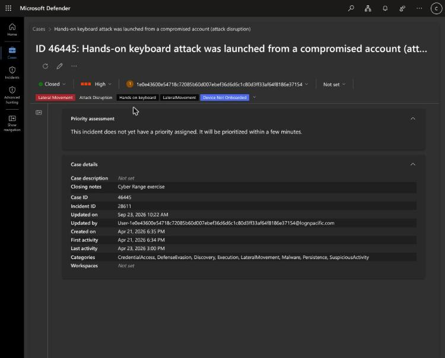

# Threat Hunt: NPT-WS01 Compromise

I did a threat hunt in Microsoft Defender XDR as part of the Cyber Range SOC program. The hunt started from a seemingly benign help desk ticket, which turned out to be a compromise.

## The ticket

> "My machine was throwing login prompts at me through the night. I ignored it and went back to sleep. Seems fine this morning."
> (Mark Smith, Finance, Help Desk Ticket #4451)

The task was to investigate whether the help desk ticket was a benign event or an attack. I was also required to reconstruct the attack, as well as provide a containment plan.

## What I found

It was, indeed, an attack. An attacker with an external IP (`20.110.92.50`) had password sprayed workstation `npt-ws01`. This resulted in ~100 failed logon attempts, using 11 different usernames within the space of 4 seconds. However, two usernames (`m.smith` and `helpdesk`) were successful in authenticating.

Once in as `helpdesk`, the attacker used **Impacket wmiexec** to run an implant in the path `C:\Windows\Temp\WindowsUpdate.exe`. This was evidenced by `wmiprvse.exe` spawning a `cmd.exe` process with the command line `/Q /c start`. The implant then proceeded to contact its C2 server, `updates.abordasync.website`, on port 443. The attacker then proceeded to establish persistence (a Run key, scheduled task, service, and local admin account as a backdoor) for a return visit. After this, the attacker proceeded toward a second host (`npt-srv01`).

The attacker chose the names to blend in with legitimate Windows/Google update components.

## Timeline (22 April 2026, UTC)

| Time | What happened |
|---|---|
| 03:42 | Password spray from 20.110.92.50, then successful logons as m.smith and helpdesk |
| 04:11 | RDP from npt-ws01 to an internal host, 10.3.0.10 |
| 04:17 | Implant written to `C:\Windows\Temp\` |
| 04:18 | wmiexec runs the implant; first C2 callback |
| 04:38 | Run key `WindowsHealthCheck` added |
| 04:43 | Scheduled task `GoogleUpdaterTask` created |
| 04:44 | Service `WindowsHealthSvc` created |
| 04:45 | `nexus_admin` created, then added to Administrators a minute later |

The full timeline, down to the second, is in the D2 report.

## How I hunted it

I hunted by performing queries on the following Advanced Hunting tables in Defender (in order):

- `DeviceLogonEvents`
- `DeviceProcessEvents` (to find wmiexec, schtasks, sc and net processes)
- `DeviceNetworkEvents` (to find C2 traffic, excluding any Microsoft domains)
- `DeviceFileEvents` (to find implant and hash)
- `DeviceRegistryEvents` (to find the Run key)

Some queries were messy; I ran a couple of queries without my `let` variables and they failed. I also accidentally pasted two queries together. It happens.

Every query I used is in [`queries/hunt-queries.kql`](queries/hunt-queries.kql).

## Reports

Both reports follow the NIST SP 800-61 incident response lifecycle.

| Report | File |
|---|---|
| **D2: Investigation Report.** What happened, timeline, impact, scope and detection point | [PDF](reports/D2-Investigation-Report.pdf) · [Word](reports/D2-Investigation-Report.docx) |
| **D1: Containment Plan.** Containment, eradication, recovery and lessons learned | [PDF](reports/D1-Containment-Plan.pdf) · [Word](reports/D1-Containment-Plan.docx) |

## Where it should have been caught

I think the best place to catch this attack was with the successful network logon from a public IP address. This event occurred at 03:42 and should have not succeeded for a workstation. This should have alerted as it was shortly after ~100 failed logon attempts in a few seconds. This alert could have prevented the attack, as it would have been more than 30 minutes before the implant was run. I wrote this up as a detection rule, as well as another two.

The rules are in [`queries/detection-rules.kql`](queries/detection-rules.kql).

## Defender case

Defender opened its own case for this one, rated High: *"Hands-on keyboard attack was launched from a compromised account (attack disruption)."*

## Indicators of compromise

| Type | Value |
|---|---|
| Attacker IP | `20.110.92.50` |
| C2 domain | `updates.abordasync.website` |
| Implant | `C:\Windows\Temp\WindowsUpdate.exe` |
| SHA256 | `20cef6a013953890f9d38605d25d60dd63b42b09946bbb18ddb4a456da306e77` |
| Compromised accounts | `helpdesk`, `m.smith` |
| Backdoor account | `nexus_admin` |
| Persistence | `WindowsHealthCheck` (Run key), `GoogleUpdaterTask`, `WindowsHealthSvc` |

## Takeaways

Takeaways from this hunt included:

- Treat "weird login prompt" help desk tickets as possible compromise. The user saw the attack happening and went back to sleep.
- Attackers are sneaky in naming their malicious components. For example, `WindowsUpdate.exe` should not be in the Temp folder.
- Parent-child processes are key in threat hunting. The parent process for wmiexec (`wmiprvse.exe`) is proof that the process was executed over WMI remotely, and not by the user.
- Persistence can come in many forms. I found four.

## Tools

Microsoft Defender XDR · KQL · NIST SP 800-61

---

*This was a lab environment run by the Cyber Range. No real systems or people were affected.*
